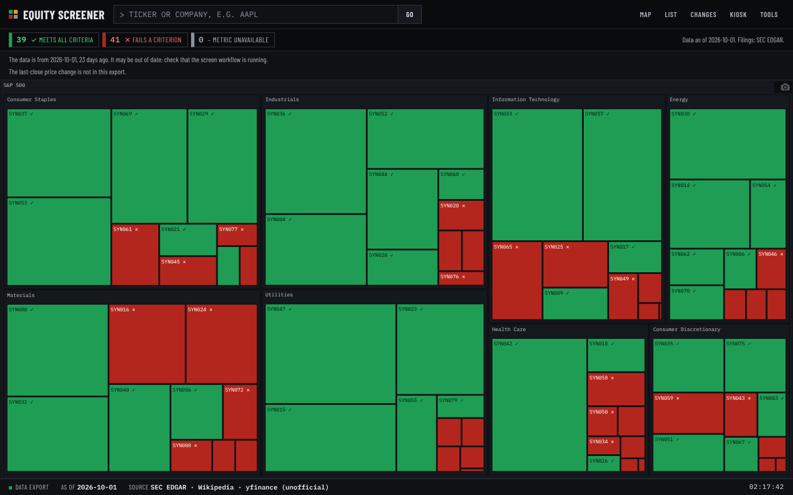
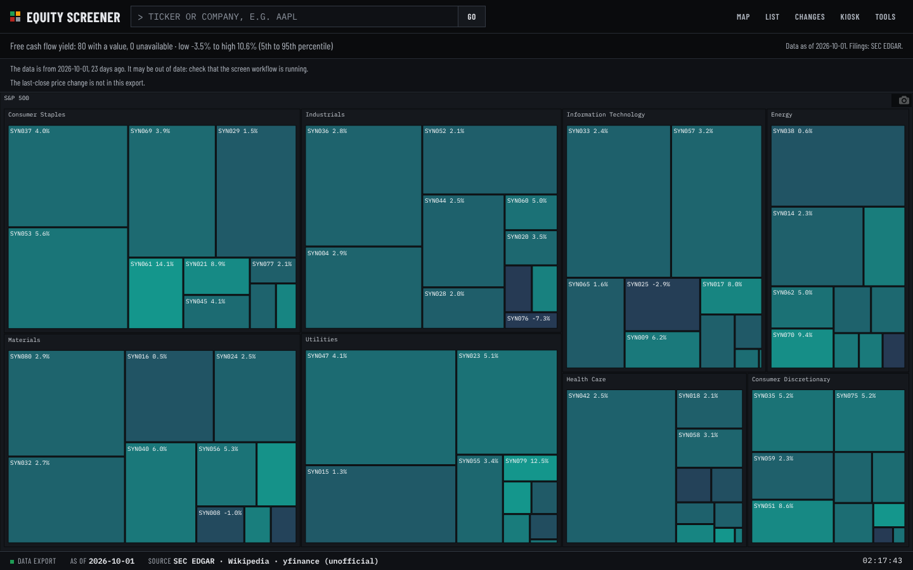
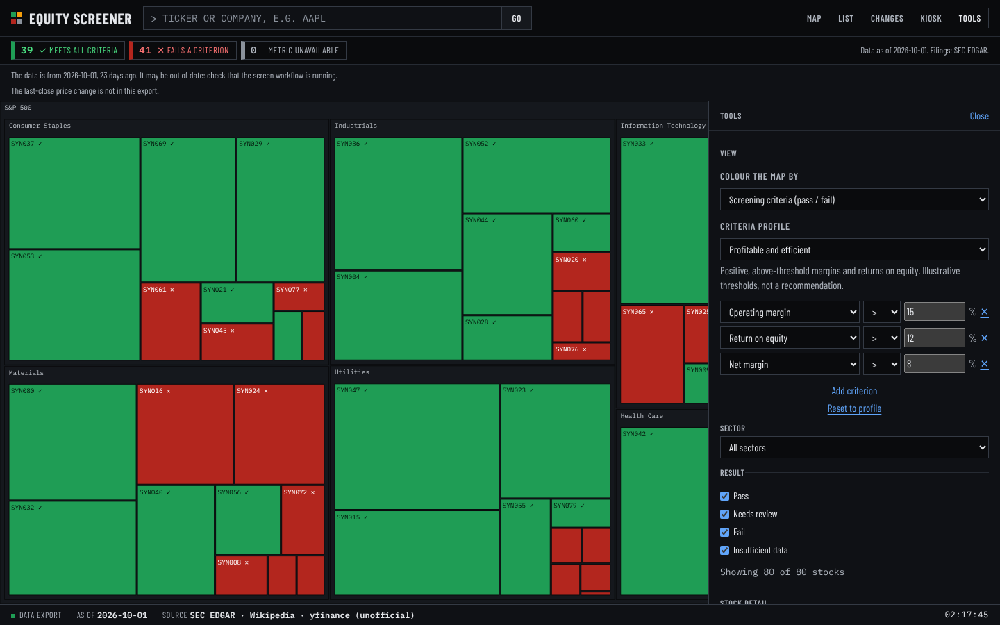

# Equity Screener

A configurable fundamental screen and heatmap of S&P 500 companies, built from SEC filings. It reads reported
figures from EDGAR, computes profitability, return, leverage, cash-flow and valuation metrics, and lets you screen on
thresholds you choose. Every figure traces to the filing it came from.



*The screenshots in this README use **synthetic data** (fictional companies, random figures; see
[`scripts/make_demo_data.py`](scripts/make_demo_data.py)) so the interface can be shown without redistributing market data.
They show the interface only and say nothing about any real company.*

## What it does

1. **Ingests SEC data.** Company facts and each filing's XBRL from EDGAR, constituents from Wikipedia, prices from yfinance.
   Only filings made on or before the screen date are read, and the screen date's own price is never used.
2. **Resolves inputs by rule, not by guess.** Each input (debt, cash, net income, equity, ...) is a list of XBRL tag
   alternatives in [`config.yaml`](config.yaml), with rules for trailing-twelve-month sums, double-counted components and
   fallbacks. An input that cannot be resolved is `None`, and every metric that needs it is shown as unavailable.
3. **Computes 19 metrics** ([definitions](#metrics)) and stores them with the facts behind them.
4. **Screens on editable criteria.** A *profile* is a short YAML file of metric thresholds. In the browser you can pick
   a profile, edit its thresholds or add criteria, and the map updates immediately. Edits stay in the browser.
5. **Colours by one metric** (heatmap view), or shows the **reference ratio screen** defined in `config.yaml`
   (ratio limits plus an optional industry exclusion list; see [docs/reference-screen.md](docs/reference-screen.md)).
6. **Tracks history.** Results are stored in SQLite; a changed result records what crossed which threshold and why
   (new filing, price move, methodology change). History only moves forward.
7. **Checks data quality before publishing.** Share-count sanity checks, market-cap windows with coverage minimums,
   stale-balance-sheet detection, and publish gates that stop a bad run from reaching the site.



## Quick start

```bash
git clone https://github.com/yasinlatif22-cpu/equity-screener && cd equity-screener
python -m venv .venv && source .venv/bin/activate
pip install -e ".[dev]"            # or: pip install -r requirements-lock.txt && pip install -e .
pytest -q                           # offline: no network needed

# Try the interface on synthetic data (no network):
python scripts/make_demo_data.py --out web/data
python -m http.server --directory web 8000   # open http://localhost:8000/tool/
```

Live data needs network access to SEC EDGAR, Wikipedia and Yahoo Finance and a contact `user_agent` in
`config.yaml` (SEC requires one that identifies you):

```bash
equity-screener screen AAPL MSFT --facts      # screen two companies and list every XBRL fact used
equity-screener screen                        # every constituent (several hours at EDGAR's rate limit)
equity-screener export --db data/screens.db   # write web/data/*.json for the site
```

## Criteria profiles

A profile is data, not code ([`profiles/`](profiles)):

```yaml
name: Profitable and efficient
description: Positive, above-threshold margins and returns on equity. Illustrative thresholds, not a recommendation.
criteria:
  - {metric: operating_margin, op: ">", value: 0.15}
  - {metric: roe, op: ">", value: 0.12}
  - {metric: net_margin, op: ">", value: 0.08}
```

A company **meets all criteria** when every metric is available and passes, **fails** when any available metric
does not pass, and is **unavailable** when nothing failed but a metric could not be computed (never treated as a pass).
The Python ([`criteria.py`](src/equity_screener/criteria.py)) and browser ([`criteria.js`](web/tool/criteria.js))
implementations are tested against the same cases ([`tests/criteria_cases.json`](tests/criteria_cases.json)).
The shipped thresholds are illustrative examples, not recommendations.



## Metrics

| Metric | Group | Definition |
|---|---|---|
| Market cap | Size | Market capitalisation on the configured basis (spot or trailing average). |
| Revenue (TTM) | Size | Trailing-twelve-month revenue. |
| Gross margin | Profitability | Gross profit / revenue, trailing twelve months. |
| Operating margin | Profitability | Operating income / revenue, trailing twelve months. |
| Net margin | Profitability | Net income / revenue, trailing twelve months. |
| Return on equity | Returns | Net income (TTM) / stockholders' equity at the balance sheet date. Undefined for non-positive equity. |
| Return on assets | Returns | Net income (TTM) / total assets at the balance sheet date. |
| Debt / market cap | Leverage | Reported debt / market cap. |
| Debt / equity | Leverage | Reported debt / stockholders' equity. Undefined for non-positive equity. |
| Liabilities / assets | Leverage | Total liabilities / total assets. |
| Cash & securities / market cap | Liquidity | Cash plus marketable securities / market cap. |
| Interest coverage | Leverage | Operating income (TTM) / interest expense (TTM). Undefined when interest expense is not positive. |
| Free cash flow margin | Cash flow | (Operating cash flow - capital expenditures) / revenue, trailing twelve months. |
| Free cash flow yield | Valuation | (Operating cash flow - capital expenditures) / market cap. |
| Earnings yield | Valuation | Net income (TTM) / market cap. |
| Price / earnings | Valuation | Market cap / net income (TTM). Undefined for non-positive earnings. |
| Price / sales | Valuation | Market cap / revenue (TTM). |
| Price / book | Valuation | Market cap / stockholders' equity. Undefined for non-positive equity. |
| Interest income / revenue | Income mix | Interest income / revenue, trailing twelve months, as disclosed (see the interest income basis). |

Ratios use trailing-twelve-month flows and the latest balance sheet. They are undefined when a denominator is not
positive. Financial companies report differently; their margins and leverage are not comparable with industrials.

## Reproducibility and data quality

- The methodology version is a hash of `config.yaml` (excluding fetch settings and the metric inputs). Every stored
  result carries it, and a changed hash re-screens everything. Results that predate the metrics are re-screened
  automatically (`metrics_backfill`).
- The full test suite runs offline against fake sources: `pytest -q`. Browser tests are skipped when Chrome is absent.
- Pinned dependencies are in `requirements-lock.txt`. CI runs the tests and the scheduled screen workflow.
- The design record for the data-quality rules is in [docs/design-record.md](docs/design-record.md) and the archived original README is in
  [docs/reference-screen.md](docs/reference-screen.md).

## Limitations

- Tag coverage varies by company and year. Where no listed tag matches, the metric is unavailable.
- Metrics are point-in-time ratios from the latest filings. There is no backtest here, and the constituent list and
  industry codes are today's values, so results must not be read as historical performance.
- Prices come from an unofficial source (yfinance) and can break or be throttled.
- The `fundamentals` tag lists in `config.yaml` were written against the XBRL taxonomy but have not yet been checked
  company by company against live filings; run `equity-screener screen <TICKER> --facts` to inspect any one company.

## Layout

```
config.yaml            reference-screen settings, input tag rules, fundamentals inputs
profiles/              criteria profiles (YAML)
src/equity_screener/   ingestion, metrics, criteria, screening engine, store, export
web/                   static landing page and the interactive tool (Plotly treemap)
scripts/               synthetic demo data generator
tests/                 offline test suite
```

Company names and marks belong to their owners. No affiliation is implied. This is a research tool, not investment advice.
